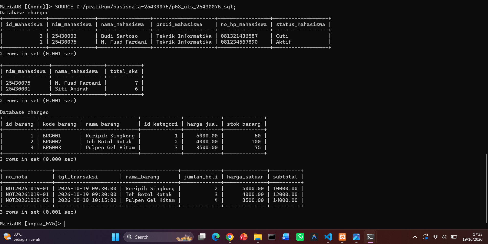

# Laporan Praktikum Basis Data - Ujian Tengah Semester (UTS)
**Nama:** M. Fuad Fardani  
**NIM:** 25430075  
**Kelas:** Sistem 3 (Praktikum Basis Data)  
**Tanggal:** 19 Oktober 2026  
**Pertemuan:** 8 (Evaluasi Ujian Tengah Semester)  

---

## 1. Tujuan Praktikum / UTS
* Mengevaluasi pemahaman komprehensif mahasiswa terkait perancangan basis data (DDL, ERD), manipulasi data (DML), pengujian *constraint*, serta kueri lanjutan dan relasional (*JOIN & Agregat*).
* Mengimplementasikan studi kasus terintegrasi pada basis data **Akademik** (`akad_075`) dan **Koperasi Mahasiswa** (`kopma_075`).

## 2. Ringkasan Evaluasi
Ujian Tengah Semester ini merangkum seluruh materi dari Modul 1 hingga Modul 7, mencakup struktur tabel, integritas relasi *Foreign Key*, validasi aturan bisnis melalui *Constraint*, serta kemampuan mengeksekusi kueri analitis menggunakan klausa penyaringan dan fungsi agregat.

## 3. Hasil Langkah Percobaan / UTS
* Berhasil merancang dan mengeksekusi skrip komprehensif UTS pada file `p08_uts_25430075.sql`.
* Berhasil menampilkan data laporan akademik dan transaksional koperasi secara akurat di server MariaDB.

## 4. Pembahasan dan Kendala
* Seluruh rangkaian pengujian perintah SQL berjalan lancar tanpa kendala sintaks maupun pelanggaran *constraint*.

## 5. Kesimpulan
Evaluasi UTS membuktikan kesiapan dalam mengelola, merancang, dan menganalisis sistem basis data secara profesional sesuai standar akademik.

## 6. Bukti Git
* **Tautan Repositori:** `https://github.com/fardani121/basisdata-25430075`
* **Pesan Commit:** `p08: evaluasi ujian tengah semester dan laporan praktikum`

---
## Checklist
- [x] Identitas lengkap
- [x] Berkas skrip SQL UTS (`p08_uts_...`) lengkap
- [x] Laporan mingguan UTS tersimpan rapi di folder laporan
- [x] Di-*push* ke GitHub